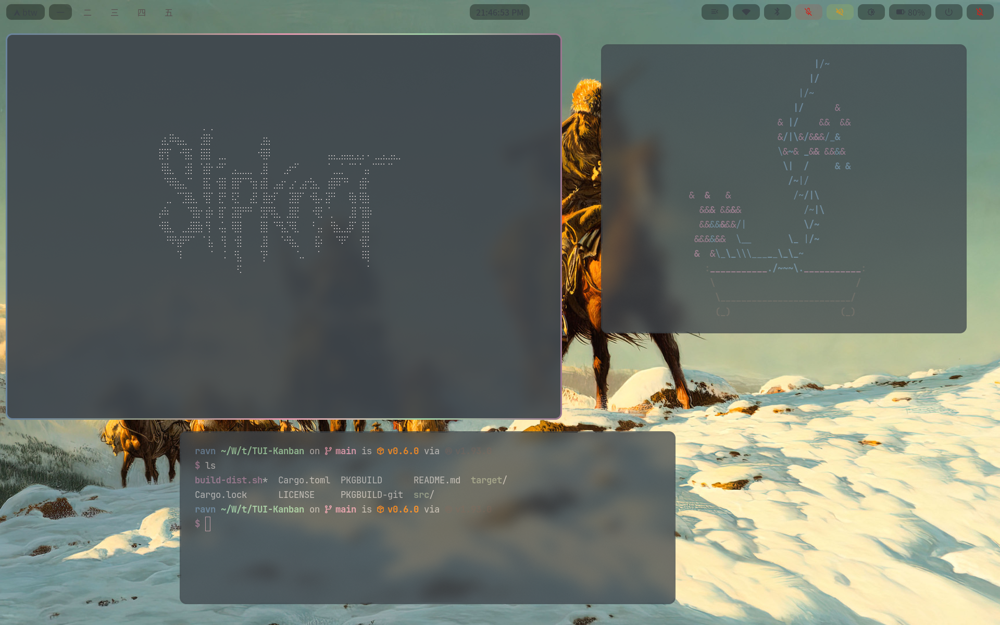
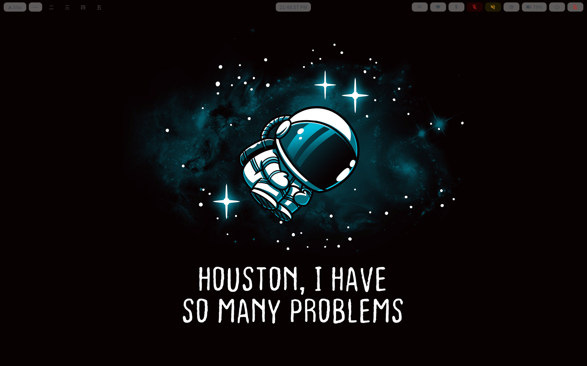

# dotfiles

My personal Hyprland rice — Wayland desktop config for Arch Linux.

## Screenshots





## Stack

| Component      | Tool |
|----------------|------|
| Compositor     | [Hyprland](https://hyprland.org/) |
| Bar            | [eww](https://github.com/elkowar/eww) |
| Launcher       | [Wofi](https://hg.sr.ht/~scoopta/wofi) |
| Notifications  | [SwayNC](https://github.com/ErikReider/SwayNotificationCenter) |
| Logout menu    | [wlogout](https://github.com/ArtsyMacaw/wlogout) |
| Idle/lock      | hypridle + hyprlock |
| Terminal       | [Ghostty](https://ghostty.org/) |
| Shell          | fish + [Starship](https://starship.rs/) |
| File manager   | [yazi](https://yazi-rs.github.io/) (TUI) |
| Wallpaper      | [awww](https://github.com/LGFae/wgpu_wallpaper_engine) + [waytrogen](https://github.com/WillPower3309/waytrogen) |
| Theming        | [wallust](https://codeberg.org/explosion-mental/wallust) (wallpaper → color palette) |
| System monitor | [btop](https://github.com/aristocratos/btop) |
| Visualizer     | [cava](https://github.com/karlstav/cava) |
| System info    | [fastfetch](https://github.com/fastfetch-cli/fastfetch) |

## Theming pipeline

Wallpaper changes trigger `scripts/theme/theme-sync.sh`, which runs `wallust` to
generate a color palette from the wallpaper and re-renders templates for
eww, wofi, swaync, wlogout, Hyprland borders, and the terminal.

Wallpaper auto-rotates every 15 minutes via a systemd user timer
(`systemd/user/wallpaper-rotate.{service,timer}` — symlink or copy these into
`~/.config/systemd/user/`, then `systemctl --user enable --now wallpaper-rotate.timer`).

## Keybinds

`$mainMod` = Super. Full binds live in `hypr/keybinds/*.lua`; highlights:

| Bind | Action |
|------|--------|
| `Super + Space` | App launcher (wofi) |
| `Super + E` | File manager (yazi) |
| `Super + W` | Browser (zen) |
| `Super + M` | Spotify |
| `Super + C` | Editor (zed) |
| `Super + Shift + S` | Region screenshot |
| `Super + Shift + F` | Toggle floating |
| `Super + X` (hold) | Drag window |
| `Super + Z` (hold) | Resize window |
| `Super + hjkl` / arrows | Focus window |
| `Super + Shift + hjkl` / arrows | Move window |

## Structure

```
hypr/       Hyprland compositor config (Lua), rules, keybinds
eww/        Status bar widgets
fontconfig/ Font fallbacks
wofi/       App launcher style
wlogout/    Logout menu
wallust/    Color palette templates
waytrogen/  Wallpaper picker config
swaync/     Notification center
scripts/    Theming, system, and utility scripts
fish/       Shell config
ghostty/    Terminal config
yazi/       File manager config
cava/       Audio visualizer config
starship.toml
```

## Notes

Hyprland is configured in Lua (`hypr/hyprland.lua` and the modules it requires).
The old hyprlang `.conf` files are kept for reference; Hyprland ignores them while
`hyprland.lua` exists. `hyprlock.conf` and `hypridle.conf` still use the hyprlang format.

The UI font is SF Pro (AUR: `otf-apple-sf-pro`, `otf-sfmono-patched`).

This is a snapshot backup, not a symlink-managed setup — copy the relevant
folders back into `~/.config` to restore.
